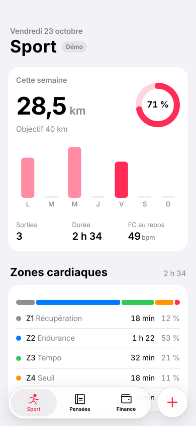
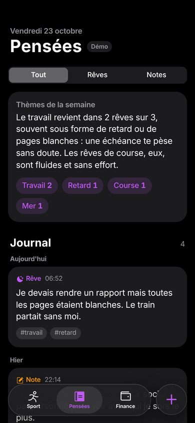
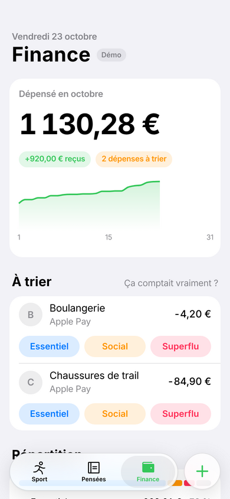
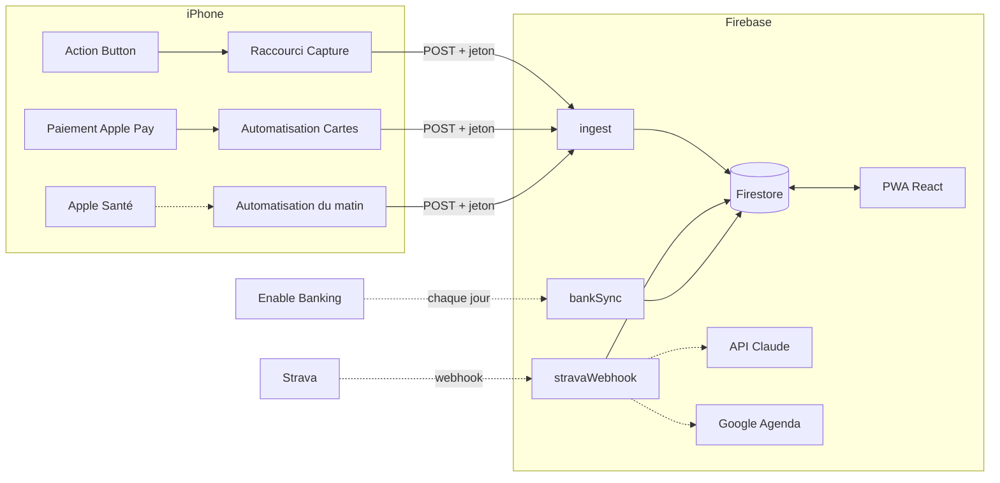

# Second cerveau

Une app perso qui rassemble mon entraînement, mes pensées et mes dépenses, et qui utilise Claude pour en tirer des conseils plutôt que des tableaux de chiffres.

**[Voir la démo](https://slzr23.github.io/second-brain/)** (données fictives, aucun compte nécessaire)

<p>
  
  
  
</p>

## Pourquoi

Les stats de course sont dans Garmin et Strava, les rêves dans les notes du téléphone, les dépenses nulle part. Chaque outil montre tout, aucun ne dit quoi en faire. Ce projet réunit les trois avec une règle : peu de chiffres, ceux qui servent, et un avis clair quand il y a quelque chose à changer.

## Ce que fait la V1

| Onglet | Fonction | État |
| --- | --- | --- |
| Pensées | Noter un rêve ou une idée en 2 secondes avec l'Action Button de l'iPhone | ✅ |
| Pensées | Journal filtrable des rêves et des notes | ✅ |
| Finance | Saisir une dépense depuis l'Action Button ou le bouton + de l'app | ✅ |
| Finance | Import automatique des paiements Apple Pay | ✅ |
| Finance | Trier chaque dépense : essentielle, sociale ou superflue | ✅ |
| Sport | Import des sorties Strava, FC, allures et zones | 🚧 |
| Sport | Compte rendu de Claude après chaque sortie, ajustement des séances de Google Agenda | 🚧 |
| Sport | Sommeil et FC au repos via Apple Santé | 🚧 |
| Pensées | Synthèse hebdomadaire des thèmes de mes rêves | 🚧 |
| Finance | Comptes bancaires, livrets, actions et bitcoin à jour | 🚧 |

## Architecture



Les traits pleins existent, les pointillés sont les prochaines étapes.

- **PWA React + Vite** installée sur l'écran d'accueil de l'iPhone, sans passer par l'App Store.
- **Un seul point d'entrée, `ingest`**, pour tout ce qui vient du téléphone. Il valide chaque requête avec Zod et renvoie un message que le raccourci affiche en notification.
- **Claude n'est appelé qu'avec des données déjà calculées** (un résumé JSON de la sortie, pas les flux bruts), une fois par sortie et une fois par semaine pour les rêves. Le coût reste de l'ordre de quelques centimes par mois.
- **Claude propose, je valide** : un ajustement de séance est stocké dans `proposals` et ne touche l'agenda qu'après acceptation.

### Modèle de données

Tout est rangé sous `users/{uid}` :

| Collection | Contenu | Écrit par |
| --- | --- | --- |
| `entries` | Rêves et notes | Raccourci, app |
| `dreamReports` | Thèmes de la semaine | Function hebdo |
| `transactions` | Montant signé en centimes, catégorie, source | Raccourci, Apple Pay, banque |
| `accounts`, `holdings` | Comptes, livrets, positions | Synchro banque, cours |
| `netWorth` | Patrimoine jour par jour | Function quotidienne |
| `activities` | Sorties et compte rendu de Claude | Webhook Strava |
| `dailyHealth` | Sommeil, FC au repos | Apple Santé |
| `weeklyStats` | Agrégats de la semaine, prêts à afficher | Function |
| `proposals` | Ajustements d'entraînement en attente | Function, puis moi |

Les montants sont des centimes entiers, pour éviter les erreurs d'arrondi. Les règles Firestore n'autorisent l'app qu'à écrire ce dont elle a besoin : créer une note, catégoriser une dépense, accepter une proposition.

## Lancer le projet

### La démo, sans rien configurer

```bash
cd web
npm install
npm run dev:demo
```

### Avec Firebase

Prérequis : Node 22, un projet Firebase (Firestore, Authentication avec Google, Functions, donc l'offre Blaze), et la CLI `firebase`.

```bash
cp .firebaserc.example .firebaserc         # puis mets l'id de ton projet
cp web/.env.example web/.env.local          # config web de ton projet Firebase
cp functions/.env.example functions/.env.<id-du-projet>   # ton uid Firebase

openssl rand -base64 32 | firebase functions:secrets:set INGEST_TOKEN --data-file=-

(cd functions && npm install) && (cd web && npm install)
firebase deploy
```

Ensuite, configure les raccourcis iPhone : [docs/action-button.md](docs/action-button.md).

### Tests

```bash
cd functions && npm test
```

## Vie privée

Ce dépôt est public, mes données non. Elles vivent uniquement dans Firestore, lisibles par mon seul compte. Les secrets (jeton d'ingestion, clés Strava, Claude et Enable Banking) sont dans Secret Manager. La démo publique ne tourne que sur des données inventées.

## Feuille de route

1. ~~Socle : PWA, Firebase, capture depuis l'Action Button~~
2. Sport : webhook Strava, statistiques, compte rendu Claude, ajustements dans Google Agenda
3. Sport : sommeil et FC au repos depuis Apple Santé
4. Finance : Enable Banking pour les comptes, cours des actions et du bitcoin, patrimoine
5. Pensées : synthèse hebdomadaire des rêves

## Stack

- **Interface** : React 19, Vite, TypeScript, PWA (Workbox). Look iOS natif : SF Pro sur Apple (Geist ailleurs), couleurs système d'Apple, gros titres, barre d'onglets flottante en verre.
- **Composants** : [Motion](https://motion.dev) pour les animations, [NumberFlow](https://number-flow.barvian.me) pour les montants animés, [Recharts](https://recharts.org) pour les graphiques, [Vaul](https://vaul.emilkowal.ski) pour la feuille de saisie, [Sonner](https://sonner.emilkowal.ski) pour les notifications, [Phosphor](https://phosphoricons.com) pour les icônes.
- **Backend** : Firebase Auth, Firestore, Cloud Functions v2 (Node 22), Zod, Vitest.
- **Outillage** : GitHub Actions (CI et démo sur GitHub Pages). La démo ne télécharge jamais Firebase : le code connecté est chargé à la demande.
